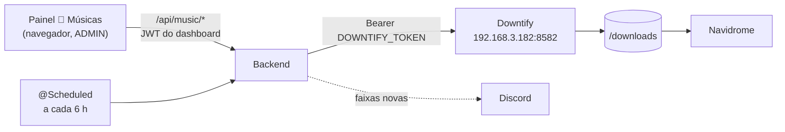

# Downloads de músicas pelo Downtify

O dashboard tem um painel **🎵 Músicas** (só para administradores) que usa o [Downtify](https://github.com/henriquesebastiao/downtify) para baixar músicas a partir de links do Spotify:

- **Baixar agora:** cole o link de uma faixa, álbum ou playlist e clique em *Baixar*. A fila do Downtify aparece logo abaixo, com o progresso de cada faixa.
- **Playlists automáticas:** cadastre uma playlist e o backend confere de tempos em tempos (padrão: a cada 6 h). Só as faixas **novas** vão para a fila. Se o [Discord](STATUS-E-AVISOS-DISCORD.md) estiver configurado, chega um aviso 🎵 com as músicas novas.



> O navegador nunca fala direto com o Downtify: o token dele fica só no backend.

---

## 1. Gerar o token do Downtify

O Downtify 3.x exige login. Para programas como o dashboard, ele emite **tokens de dispositivo** (`dtfy_...`). Gere um com o usuário e a senha que você usa no Downtify:

```bash
curl -s http://192.168.3.182:8582/api/auth/token \
  -H 'Content-Type: application/json' \
  -d '{"username":"admin","password":"SUA-SENHA","device_name":"Homelab Hub","platform":"server"}'
```

Na resposta, copie o valor que começa com **`dtfy_`**. Ele é o `DOWNTIFY_TOKEN`. Trate-o como senha.

> Se o seu Downtify roda com `DOWNTIFY_DISABLE_AUTH=true`, não precisa de token: deixe `DOWNTIFY_TOKEN` vazio.

Para conferir a versão do Downtify (precisa ser **3.x**):

```bash
curl -s http://192.168.3.182:8582/api/health
# {"status":"ok","version":"3.12.0"}
```

---

## 2. Configurar o backend

| Variável                 | Exemplo                       | Obrigatória | O que faz |
|--------------------------|-------------------------------|-------------|-----------|
| `DOWNTIFY_URL`           | `http://192.168.3.182:8582`   | sim         | Endereço do Downtify. **Vazio = painel escondido.** |
| `DOWNTIFY_TOKEN`         | `dtfy_...`                    | quase sempre | Token do passo 1. |
| `DOWNTIFY_SYNC_INTERVAL` | `6h` (padrão), `30m`, `1d`    | não         | De quanto em quanto tempo as playlists são conferidas. |
| `DOWNTIFY_TIMEOUT`       | `60s` (padrão)                | não         | Tempo máximo de cada chamada (playlists grandes demoram). |

### Desenvolvimento

```bash
DOWNTIFY_URL=http://192.168.3.182:8582 DOWNTIFY_TOKEN='dtfy_...' ./mvnw spring-boot:run
```

### Produção (Jenkins)

O [`compose.prod.yaml`](../compose.prod.yaml) já repassa as duas variáveis. Falta defini-las no pipeline:

1. No Jenkins, crie uma credencial **Secret text** com o ID **`homepage-downtify-token`** e o token como valor (mesmo passo a passo da [credencial do Discord](STATUS-E-AVISOS-DISCORD.md#42-passo-1-criar-a-credencial-no-jenkins)).
2. No [`Jenkinsfile`](../Jenkinsfile):

```diff
     environment {
         ...
         ADMIN_EMAIL = '...'
+        DOWNTIFY_URL = 'http://192.168.3.182:8582'
         DOCKER_BUILDKIT = '1'
     }
 ...
                 withCredentials([
                     string(credentialsId: 'homepage-db-password',    variable: 'DB_PASSWORD'),
                     string(credentialsId: 'homepage-jwt-secret',     variable: 'JWT_SECRET'),
-                    string(credentialsId: 'homepage-admin-password', variable: 'ADMIN_PASSWORD')
+                    string(credentialsId: 'homepage-admin-password', variable: 'ADMIN_PASSWORD'),
+                    string(credentialsId: 'homepage-downtify-token', variable: 'DOWNTIFY_TOKEN')
                 ]) {
```

> ⚠️ Crie a credencial **antes** do push, senão o estágio Deploy falha com `CredentialNotFoundException`.

Depois do deploy, o painel aparece no topo do dashboard para administradores, com o selo **Downtify 3.x · online**.

---

## 3. Usando

### Baixar agora

| Link colado | O que acontece |
|---|---|
| `https://open.spotify.com/track/...` | 1 faixa vai para a fila |
| `https://open.spotify.com/album/...` | Todas as faixas do álbum |
| `https://open.spotify.com/playlist/...` | Todas as faixas + arquivo `.m3u` da playlist (o Navidrome importa) |

Também aceita links com `/intl-pt/`, `?si=...` e o formato `spotify:track:...`. Links de artista, podcast ou de outros sites são recusados com uma mensagem.

### Playlists automáticas

1. Cole o link da playlist em **Playlists automáticas** e clique em **Acompanhar**. O nome vem do Spotify, a menos que você informe outro.
2. Na hora, **todas as faixas atuais** vão para a fila (primeira sincronização).
3. A cada `DOWNTIFY_SYNC_INTERVAL`, só as faixas adicionadas depois disso são baixadas.

Em cada playlist:
- **Automática:** desmarque para pausar sem perder o histórico.
- **Sincronizar:** confere na hora, sem esperar o intervalo.
- **✕:** para de acompanhar (as músicas já baixadas continuam no Downtify).

Comportamentos a saber:
- Faixas **removidas** da playlist no Spotify não são apagadas do disco.
- Se o Downtify estiver fora do ar, a sincronização é registrada com erro (a playlist fica com borda vermelha) e as faixas são tentadas de novo no próximo ciclo.
- A sincronização automática e o botão *Sincronizar* nunca rodam ao mesmo tempo: se você clicar durante uma automática, aparece "Já existe uma sincronização em andamento".

---

## 4. Problemas comuns

| Sintoma | Causa provável | Solução |
|---|---|---|
| O painel não aparece | `DOWNTIFY_URL` vazio, ou usuário não é ADMIN | Defina a variável e refaça o deploy |
| Selo **Downtify indisponível** | O container do backend não alcança o Downtify | Teste de dentro do container: `docker compose -p homepage -f compose.prod.yaml exec backend bash -c 'echo > /dev/tcp/192.168.3.146/8582 && echo ok'` |
| "O Downtify recusou o acesso: confira o DOWNTIFY_TOKEN" (HTTP 401) | Token errado, expirado ou o dispositivo foi desvinculado no Downtify | Gere outro token (passo 1) |
| "O Downtify não permite esta ação pelo dashboard" (HTTP 403) | O token é válido, mas o Downtify só libera essa ação com login na página dele | Faça pela página do Downtify (link **Abrir no Downtify ↗**) |
| "O Downtify respondeu HTTP 404" em tudo | Downtify 2.x ou anterior (outra API) | Atualize para a imagem `ghcr.io/henriquesebastiao/downtify:3` |
| "O Downtify não encontrou nada para esse link" | Playlist privada ou link quebrado | Deixe a playlist pública no Spotify |

---

## 5. Referência técnica

Rotas do dashboard (todas exigem ADMIN):

| Método | Rota | Resposta |
|---|---|---|
| GET | `/api/music/status` | `{ configured, reachable, version, syncInterval, url }` |
| POST | `/api/music/downloads` `{ url }` | 202 `{ queued, type }` |
| GET | `/api/music/queue` | `[{ title, artists, status, progress, message }]` |
| GET / POST | `/api/music/playlists` (`{ url, name? }`) | lista / 201 com a playlist já sincronizada |
| PUT | `/api/music/playlists/{id}` `{ enabled }` | playlist |
| DELETE | `/api/music/playlists/{id}` | 204 |
| POST | `/api/music/playlists/{id}/sync` | playlist com o resultado |

Rotas do Downtify usadas pelo backend: `GET /api/health`, `GET /api/song/url`, `POST /api/download/batch`, `GET /api/queue`.

> O Downtify 3.13 **não deixa tokens de dispositivo limparem a fila** (`DELETE /api/queue/completed` responde 403 para o token, mas funciona com login na página dele). Por isso o painel tem o link **Abrir no Downtify ↗** em vez de um botão de limpar.

Tabelas criadas automaticamente (`ddl-auto: update`): `music_playlist` e `music_playlist_song` (as faixas já enviadas de cada playlist).

Código: `domain/music/` no backend ([`DowntifyClient`](../src/main/java/com/homelab/homepage/domain/music/client/DowntifyClient.java), [`MusicService`](../src/main/java/com/homelab/homepage/domain/music/service/MusicService.java)) e [`MusicPanel.vue`](../../homelab-hub-frontend/src/components/MusicPanel.vue) no frontend.
