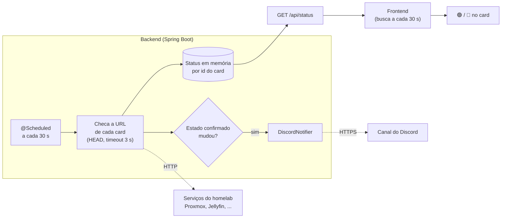
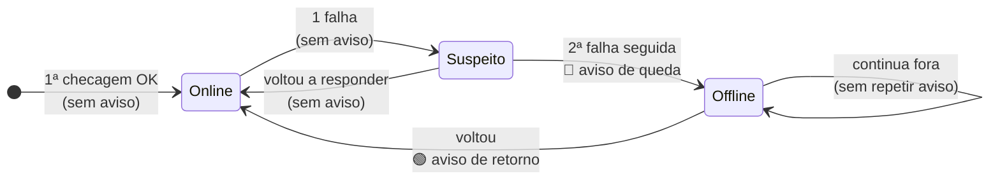
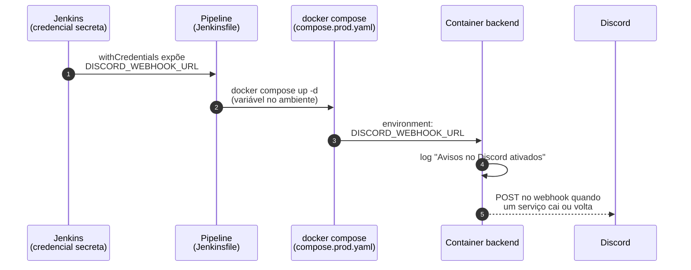
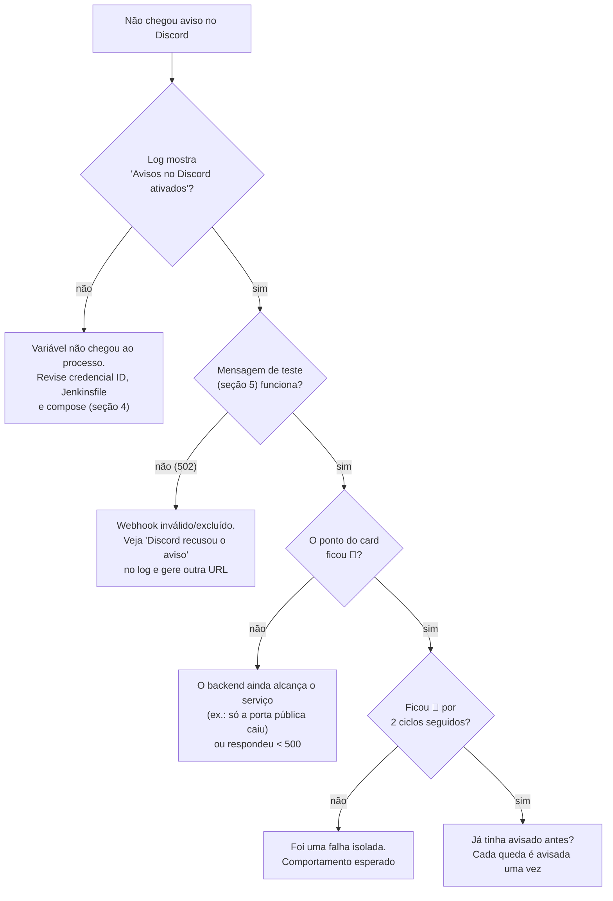

# Status online/offline e avisos no Discord

Guia de configuração passo a passo. Cobre:

1. [Como funciona](#1-como-funciona)
2. [Criar o webhook no Discord](#2-criar-o-webhook-no-discord)
3. [Testar o webhook localmente (desenvolvimento)](#3-testar-localmente-desenvolvimento)
4. [Configurar em produção (Jenkins + Docker Compose)](#4-configurar-em-produção-jenkins--docker-compose)
5. [Enviar a mensagem de teste](#5-enviar-a-mensagem-de-teste)
6. [Ajustes finos (variáveis de ambiente)](#6-ajustes-finos-variáveis-de-ambiente)
7. [Problemas comuns](#7-problemas-comuns)
8. [Referência técnica](#8-referência-técnica)

> **Sobre as ilustrações:** os diagramas usam [Mermaid](https://mermaid.js.org/) e aparecem desenhados no GitHub/GitLab.
> No VS Code, instale a extensão *Markdown Preview Mermaid Support* para vê-los no preview.
> As telas do Discord e do Jenkins são esboços em texto: a disposição pode mudar um pouco entre versões, mas os nomes dos menus são os mesmos.

---

## 1. Como funciona

### 1.1 Visão geral



- **Nada vai para o banco de dados**: o status vive só na memória do backend e é refeito alguns segundos depois de cada reinício.
- **Online** = o serviço respondeu com qualquer código HTTP **abaixo de 500** (inclusive 401, 403, 404: o servidor está de pé, só pede login).
- **Offline** = respondeu 5xx, estourou o timeout ou recusou a conexão.
- Cards com link `#` não são verificados e ficam sem indicador.

### 1.2 Quando um aviso é enviado

Para evitar alarme falso (uma oscilação de rede, um restart rápido), o aviso de queda só sai depois de **2 falhas seguidas**, e cada mudança é avisada **uma única vez**.



Exemplo real, com checagens a cada 30 s:

| Hora     | Resposta     | Indicador no card | Mensagem no Discord                         |
|----------|--------------|-------------------|---------------------------------------------|
| 10:00:00 | 200          | 🟢                | —                                           |
| 10:00:30 | timeout      | 🔴                | — *(1 falha, ainda pode ser oscilação)*     |
| 10:01:00 | 200          | 🟢                | —                                           |
| 10:01:30 | 502          | 🔴                | —                                           |
| 10:02:00 | 502          | 🔴                | **🔴 Jellyfin está offline**                |
| 10:02:30 | timeout      | 🔴                | — *(já avisado)*                            |
| 10:08:00 | 200          | 🟢                | **🟢 Jellyfin voltou · fora do ar por 6 min** |

> O indicador no card mostra sempre o resultado da **última** checagem; só os avisos esperam as 2 falhas.
> O tempo "fora do ar" é contado a partir da **primeira** falha (10:01:30 no exemplo).

### 1.3 Como as mensagens aparecem no Discord

```
┌──────────────────────────────────────────────────────────────┐
│ 🤖 Homelab Hub  BOT  Hoje às 10:02                            │
│ ┃                                                            │
│ ┃ 🔴 Jellyfin está offline                                   │  ← faixa vermelha
│ ┃ http://192.168.3.183:8096                                  │
│ ┃                                                            │
│ ┃ Motivo                                                     │
│ ┃ Respondeu HTTP 502                                         │
│ ┃                                                            │
│ ┃ hoje às 10:02                                              │
└──────────────────────────────────────────────────────────────┘

┌──────────────────────────────────────────────────────────────┐
│ 🤖 Homelab Hub  BOT  Hoje às 10:08                            │
│ ┃                                                            │
│ ┃ 🟢 Jellyfin voltou                                          │  ← faixa verde
│ ┃ http://192.168.3.183:8096                                  │
│ ┃                                                            │
│ ┃ Latência          Ficou fora do ar por                     │
│ ┃ 42 ms             6 min                                    │
│ ┃                                                            │
│ ┃ hoje às 10:08                                              │
└──────────────────────────────────────────────────────────────┘
```

O título é um link: clicar nele abre o serviço.

---

## 2. Criar o webhook no Discord

Um *webhook* é uma URL secreta que permite postar mensagens num canal sem precisar de um bot.

**Pré-requisito:** permissão **Gerenciar webhooks** no servidor (o dono do servidor tem por padrão).

### Passo 1: escolha (ou crie) o canal

Recomendado: um canal só para isso, por exemplo `#homelab-alertas`. Assim você pode silenciar ou destacar as notificações dele separadamente.

### Passo 2: abra as configurações do canal

Passe o mouse sobre o nome do canal e clique na **engrenagem** (⚙ *Editar canal*):

```
┌─ SEU SERVIDOR ──────────────┐
│                             │
│ ▾ CANAIS DE TEXTO           │
│   # geral                   │
│   # homelab-alertas   👤+ ⚙ │  ← clique na engrenagem
│                             │
└─────────────────────────────┘
```

### Passo 3: vá em Integrações → Webhooks

```
┌──────────────────────┬──────────────────────────────────────────────┐
│ # HOMELAB-ALERTAS    │  Integrações                                 │
│                      │                                              │
│  Visão geral         │  ┌────────────────────────────────────────┐  │
│  Permissões          │  │ 🔗 Webhooks                             │  │
│  Convites            │  │    0 webhooks          [Criar webhook] │  │ ← clique
│ ▶Integrações         │  └────────────────────────────────────────┘  │
│                      │                                              │
│  Excluir canal       │                                              │
└──────────────────────┴──────────────────────────────────────────────┘
```

Se já existir algum webhook, o botão se chama **Ver webhooks** e, na tela seguinte, **Novo webhook**.

### Passo 4: configure e copie a URL

O Discord cria um webhook com nome aleatório (ex.: "Spidey Bot"). Clique nele para expandir:

```
┌──────────────────────────────────────────────────────────────────┐
│  ┌─────┐   NOME                       CANAL                      │
│  │ 🤖  │   [ Homelab Hub          ]   [ # homelab-alertas   ▾ ]  │
│  │     │                                                         │
│  └─────┘                                                         │
│  Enviar imagem                                                   │
│                                                                  │
│  [ Copiar URL do webhook ]        Excluir webhook                │ ← clique
└──────────────────────────────────────────────────────────────────┘
          ┌──────────────────────────────────────────────┐
          │  Você tem alterações que não foram salvas!   │
          │                   Redefinir  [Salvar alterações] │ ← salve
          └──────────────────────────────────────────────┘
```

1. (Opcional) Mude o nome e o avatar. O nome que aparece nas mensagens vem da variável `DISCORD_USERNAME` (padrão: *Homelab Hub*), então o nome aqui serve só para você reconhecer o webhook nesta lista.
2. Clique em **Copiar URL do webhook**.
3. Clique em **Salvar alterações**.

A URL copiada tem este formato:

```
https://discord.com/api/webhooks/123456789012345678/AbCdEf...xYz
                                 └──── id ────────┘ └── token ──┘
```

> ⚠️ **Trate essa URL como uma senha.** Qualquer pessoa com ela pode postar no seu canal.
> Não coloque no `application.yaml`, no `Jenkinsfile` nem em nenhum arquivo versionado no Git.
> Se ela vazar, volte nesta tela, clique em **Excluir webhook** e crie outro.

---

## 3. Testar localmente (desenvolvimento)

O webhook é lido da variável de ambiente `DISCORD_WEBHOOK_URL`. **Sem ela, os avisos ficam desligados** e o resto funciona normalmente.

### 3.1 Rodando com Maven

```bash
cd homelab-hub-backend

docker compose up -d            # sobe o Postgres local

DISCORD_WEBHOOK_URL='https://discord.com/api/webhooks/...' \
ADMIN_EMAIL=voce@exemplo.com \
ADMIN_PASSWORD=uma-senha-forte \
./mvnw spring-boot:run
```

Use aspas simples na URL para o shell não interpretar nenhum caractere do token.

### 3.2 Rodando pela IDE (VS Code / IntelliJ)

Adicione a variável na configuração de execução:

- **VS Code** (`.vscode/launch.json`):
  ```json
  {
    "type": "java",
    "name": "HomepageApplication",
    "request": "launch",
    "mainClass": "com.homelab.homepage.HomepageApplication",
    "env": {
      "DISCORD_WEBHOOK_URL": "https://discord.com/api/webhooks/..."
    }
  }
  ```
  > Se o `.vscode/` for versionado, prefira `"envFile": "${workspaceFolder}/.env"` e coloque o `.env` no `.gitignore`.
- **IntelliJ:** *Run → Edit Configurations… → Environment variables* → `DISCORD_WEBHOOK_URL=https://...`

### 3.3 Confirme que ligou

Na inicialização, o log deve mostrar:

```
INFO  c.h.h.d.status.notify.DiscordNotifier : Avisos no Discord ativados
```

Se essa linha não aparecer, a variável não chegou ao processo. Depois, siga para o [passo 5](#5-enviar-a-mensagem-de-teste).

### 3.4 Simular uma queda

O jeito mais simples de ver um aviso de verdade:

1. Crie um card apontando para algo que você pode desligar, por exemplo um container de teste:
   ```bash
   docker run -d --name teste-aviso -p 8999:80 nginx
   ```
   URL do card: `http://<ip-da-maquina>:8999`
2. Espere o ponto ficar 🟢.
3. Derrube o container: `docker stop teste-aviso`.
4. Em **~1 minuto** (2 ciclos de 30 s) chega o 🔴 no Discord.
5. `docker start teste-aviso` → no próximo ciclo chega o 🟢.
6. Limpeza: `docker rm -f teste-aviso` e apague o card.

---

## 4. Configurar em produção (Jenkins + Docker Compose)

### 4.1 Como a URL chega até o container



O `compose.prod.yaml` **já está pronto** (repassa `DISCORD_WEBHOOK_URL` para o backend). Faltam dois passos: criar a credencial no Jenkins e expô-la no `Jenkinsfile`.

### 4.2 Passo 1: criar a credencial no Jenkins

1. Acesse o Jenkins e vá em **Gerenciar Jenkins** (*Manage Jenkins*).
2. Em *Security*, clique em **Credentials**.
3. Clique no domínio **(global)**, dentro de *System → Global credentials (unrestricted)*.
4. Clique em **+ Add Credentials**.

```
Painel de controle › Gerenciar Jenkins › Credentials › System › Global credentials (unrestricted)

┌──────────────────────────────────────────────────────────────────────┐
│  New credentials                                                     │
│                                                                      │
│  Kind                                                                │
│  [ Secret text                                               ▾ ]     │ ← "Secret text"
│                                                                      │
│  Scope                                                               │
│  [ Global (Jenkins, nodes, items, all child items, etc)      ▾ ]     │
│                                                                      │
│  Secret                                                              │
│  [ •••••••••••••••••••••••••••••••••••••••••••••••••••••••• ]        │ ← cole a URL do webhook
│                                                                      │
│  ID                                                                  │
│  [ homepage-discord-webhook                                  ]       │ ← exatamente este ID
│                                                                      │
│  Description                                                         │
│  [ Webhook do Discord - avisos do Homelab Hub                ]       │
│                                                                      │
│  [ Create ]                                                          │
└──────────────────────────────────────────────────────────────────────┘
```

| Campo       | Valor                                              |
|-------------|----------------------------------------------------|
| Kind        | **Secret text**                                    |
| Scope       | Global                                             |
| Secret      | a URL completa do webhook                          |
| ID          | **`homepage-discord-webhook`**: tem que ser igual ao do Jenkinsfile |
| Description | livre                                              |

Ela vai aparecer na lista ao lado das credenciais que o projeto já usa:

```
 ID                          Name                                     Kind
 homepage-db-password        ••••••                                   Secret text
 homepage-jwt-secret         ••••••                                   Secret text
 homepage-admin-password     ••••••                                   Secret text
 homepage-discord-webhook    Webhook do Discord - avisos do Homelab   Secret text   ← nova
```

### 4.3 Passo 2: expor a credencial no `Jenkinsfile`

No estágio **Deploy** do [`Jenkinsfile`](../Jenkinsfile), acrescente uma linha ao `withCredentials`:

```diff
             steps {
                 withCredentials([
                     string(credentialsId: 'homepage-db-password',    variable: 'DB_PASSWORD'),
                     string(credentialsId: 'homepage-jwt-secret',     variable: 'JWT_SECRET'),
-                    string(credentialsId: 'homepage-admin-password', variable: 'ADMIN_PASSWORD')
+                    string(credentialsId: 'homepage-admin-password', variable: 'ADMIN_PASSWORD'),
+                    string(credentialsId: 'homepage-discord-webhook', variable: 'DISCORD_WEBHOOK_URL')
                 ]) {
                     sh 'docker compose -f compose.prod.yaml up -d --remove-orphans'
                 }
```

> ⚠️ **Ordem importa:** crie a credencial (4.2) **antes** de fazer push desta alteração.
> Se o Jenkins não encontrar o ID `homepage-discord-webhook`, o estágio Deploy falha com
> `CredentialNotFoundException` e a versão nova não sobe.

O Jenkins mascara o valor nos logs do build (aparece como `****`), então a URL não vaza no console.

### 4.4 Passo 3: deploy e verificação

1. Faça commit e push do `Jenkinsfile` para a `main`.
2. Acompanhe o build. Os estágios *Deploy* e *Smoke test* devem passar.
3. Confira no log do container:
   ```bash
   docker compose -p homepage -f compose.prod.yaml logs backend | grep -i discord
   ```
   Esperado:
   ```
   INFO  ... DiscordNotifier : Avisos no Discord ativados
   ```
4. Confirme que a variável chegou ao container (mostra só o começo da URL):
   ```bash
   docker compose -p homepage -f compose.prod.yaml exec backend \
     sh -c 'echo "${DISCORD_WEBHOOK_URL%%/api/*}/api/..."'
   ```
   Esperado: `https://discord.com/api/...`

### 4.5 Alternativa sem Jenkins (deploy manual)

Se você subir o compose manualmente, crie um `.env` **ao lado** do `compose.prod.yaml`. O Docker Compose lê esse arquivo sozinho:

```bash
# homelab-hub-backend/.env   (já está no .gitignore; nunca faça commit dele)
DISCORD_WEBHOOK_URL=https://discord.com/api/webhooks/...
```

```bash
docker compose -f compose.prod.yaml up -d
```

---

## 5. Enviar a mensagem de teste

A rota `POST /api/status/test-notification` envia uma mensagem de teste e informa se o Discord aceitou. **Só administradores** podem chamá-la.

```
┌──────────────────────────────────────────────────────────────┐
│ 🤖 Homelab Hub  BOT  Hoje às 14:30                            │
│ ┃                                                            │
│ ┃ ✅ Teste do Homelab Hub                                     │  ← faixa azul
│ ┃                                                            │
│ ┃ Status                                                     │
│ ┃ Os avisos de queda e retorno vão chegar neste canal.       │
└──────────────────────────────────────────────────────────────┘
```

### Pelo terminal (curl)

```bash
HOST=http://192.168.3.183:8081      # em dev: http://localhost:8080

# 1. Login como administrador: guarda o token JWT
TOKEN=$(curl -s "$HOST/api/v1/auth/login" \
  -H 'Content-Type: application/json' \
  -d '{"email":"voce@exemplo.com","password":"sua-senha"}' \
  | sed -E 's/.*"token":"([^"]+)".*/\1/')

# 2. Dispara a mensagem de teste
curl -i -X POST "$HOST/api/status/test-notification" \
  -H "Authorization: Bearer $TOKEN"
```

Saída esperada:

```
HTTP/1.1 200
Content-Type: application/json

{"message":"Mensagem de teste enviada"}
```

> O Swagger (`/swagger-ui.html`) lista a rota, mas hoje não tem o botão **Authorize** para enviar o token,
> porque o `OpenApiConfig` não declara um esquema de segurança. Por isso, use o curl.

### Respostas possíveis

| HTTP | Corpo                                                  | Significado                                       |
|------|--------------------------------------------------------|---------------------------------------------------|
| 200  | `Mensagem de teste enviada`                            | ✅ Pronto, confira o canal                        |
| 400  | `DISCORD_WEBHOOK_URL nao configurado`                  | A variável não chegou ao backend, veja a [seção 7](#7-problemas-comuns) |
| 502  | `O Discord recusou a mensagem; veja os logs`           | URL inválida ou webhook excluído, veja o log      |
| 401  | `Autenticacao necessaria`                              | Token ausente ou expirado: faça login de novo     |
| 403  | `Voce nao tem permissao para esta acao`                | O usuário não é ADMIN                             |

---

## 6. Ajustes finos (variáveis de ambiente)

Todas são opcionais. Os padrões ficam em [`application.yaml`](../src/main/resources/application.yaml).

### Verificação de status

| Variável              | Padrão | O que faz                                                                 |
|-----------------------|--------|---------------------------------------------------------------------------|
| `STATUS_INTERVAL`     | `30s`  | Intervalo entre ciclos de verificação. Aceita `30s`, `1m`, `PT45S`…       |
| `STATUS_TIMEOUT`      | `3s`   | Quanto esperar cada serviço responder antes de considerar offline.        |
| `STATUS_INSECURE_TLS` | `true` | Aceita certificados autoassinados (Proxmox, TrueNAS…). `false` exige certificado válido. |

### Avisos no Discord

| Variável                   | Padrão        | O que faz                                                      |
|----------------------------|---------------|----------------------------------------------------------------|
| `DISCORD_WEBHOOK_URL`      | *(vazio)*     | URL do webhook. Vazio = avisos desligados.                     |
| `DISCORD_USERNAME`         | `Homelab Hub` | Nome exibido como autor das mensagens.                         |
| `NOTIFY_FAILURE_THRESHOLD` | `2`           | Falhas seguidas antes de avisar a queda (mínimo 1).            |

**Quanto tempo até o aviso chegar?** Aproximadamente:

```
tempo até o aviso ≈ NOTIFY_FAILURE_THRESHOLD × STATUS_INTERVAL (+ até STATUS_TIMEOUT)
```

| Intervalo | Limite | Aviso de queda em | Perfil                                    |
|-----------|--------|-------------------|-------------------------------------------|
| `30s`     | `2`    | ~1 min            | **Padrão**: equilíbrio                    |
| `15s`     | `2`    | ~30 s             | Mais rápido, mais requisições             |
| `30s`     | `3`    | ~1,5 min          | Rede instável / Wi-Fi                     |
| `1m`      | `3`    | ~3 min            | Bem tolerante, quase sem falso positivo   |

Para aplicar em produção, adicione a variável no bloco `environment:` do backend em `compose.prod.yaml`:

```yaml
    environment:
      # ...
      DISCORD_WEBHOOK_URL: ${DISCORD_WEBHOOK_URL:-}
      NOTIFY_FAILURE_THRESHOLD: "3"
      STATUS_INTERVAL: 1m
```

---

## 7. Problemas comuns



| Sintoma | Causa provável | Solução |
|---|---|---|
| Teste retorna **400 "nao configurado"** | Variável não chegou ao container | Confira o ID da credencial, a linha no `withCredentials` e o `compose.prod.yaml`; refaça o deploy |
| Build falha com **`CredentialNotFoundException`** | Credencial `homepage-discord-webhook` não existe ou tem outro ID | Crie a credencial no Jenkins com o ID exato (seção 4.2) |
| Teste retorna **502** e log mostra `HTTP 401` ou `404` | Webhook excluído ou URL copiada errada | Gere uma nova URL no Discord e atualize a credencial |
| Log mostra `HTTP 429` | Muitas mensagens em pouco tempo (rate limit do Discord) | Normal só se muitos serviços caírem juntos; aumente `NOTIFY_FAILURE_THRESHOLD` se acontecer sempre |
| Log mostra `Falha ao enviar aviso ... ConnectException` | Container sem acesso à internet / DNS | Teste `docker compose -p homepage -f compose.prod.yaml exec backend bash -c 'echo > /dev/tcp/discord.com/443 && echo ok'` |
| Card sempre 🔴, mas o serviço abre no navegador | A URL do card só funciona na **sua** máquina (`localhost`, nome local) | Use o IP da LAN ou um nome que o container resolva; `localhost` dentro do container é o próprio container |
| Card sempre 🔴 com HTTPS | Certificado inválido com `STATUS_INSECURE_TLS=false` | Volte para `true` ou use um certificado válido |
| Recebeu "offline" logo após reiniciar o backend | O serviço já estava fora antes do restart | Esperado: o estado é refeito do zero a cada inicialização |
| Não recebeu aviso logo após **editar** um card | A checagem imediata pós-edição não conta para avisos (proposital) | Aguarde 2 ciclos normais |

Para ver tudo que o backend registrou sobre o Discord:

```bash
docker compose -p homepage -f compose.prod.yaml logs -f backend | grep -iE "discord|aviso"
```

---

## 8. Referência técnica

### Arquivos envolvidos

```
homelab-hub-backend/
├── compose.prod.yaml                         repassa DISCORD_WEBHOOK_URL ao container
├── Jenkinsfile                               withCredentials → DISCORD_WEBHOOK_URL
└── src/main/
    ├── resources/application.yaml            app.status.* e app.notify.*
    └── java/com/homelab/homepage/
        ├── HomepageApplication.java          @EnableScheduling
        ├── common/config/SecurityConfig.java libera GET /api/status e protege o teste
        ├── domain/catalog/service/
        │   └── CatalogService.java           checa na hora ao criar/editar; limpa ao excluir
        └── domain/status/
            ├── model/ServiceStatus.java      record: state, latencyMs, httpStatus, checkedAt
            ├── service/StatusService.java    agendamento, checagem, contagem de falhas
            ├── notify/DiscordNotifier.java   monta o embed e faz POST no webhook
            └── controller/StatusController.java

homelab-hub-frontend/src/
├── data/catalogApi.js                        fetchStatus()
├── data/useStatus.js                         busca /api/status a cada 30 s
├── components/Dashboard.vue                  passa o status para cada card
└── components/ServiceCard.vue                ponto 🟢/🔴 + tooltip
```

### Endpoints

| Método | Rota                             | Quem          | Resposta |
|--------|----------------------------------|---------------|----------|
| GET    | `/api/status`                    | USER, ADMIN   | Mapa `{ idDoCard: status }` |
| POST   | `/api/status/test-notification`  | ADMIN         | `{ "message": "..." }` (ver seção 5) |

Exemplo de `GET /api/status`:

```json
{
  "3": { "state": "UP",      "latencyMs": 42,   "httpStatus": 200,  "checkedAt": "2026-11-20T13:02:00Z" },
  "7": { "state": "DOWN",    "latencyMs": null, "httpStatus": 502,  "checkedAt": "2026-11-20T13:02:00Z" },
  "9": { "state": "DOWN",    "latencyMs": null, "httpStatus": null, "checkedAt": "2026-11-20T13:02:00Z" },
  "12":{ "state": "UNKNOWN", "latencyMs": null, "httpStatus": null, "checkedAt": "2026-11-20T13:02:00Z" }
}
```

- `httpStatus: null` com `DOWN` = sem resposta (timeout, conexão recusada, DNS).
- `UNKNOWN` = URL não é http(s) válida.

### Indicador no frontend

```
┌───────────────────────────────────┐        Tooltip ao passar o mouse:
│ ┌────┐                          ● │  ← 🟢  "Online · 42 ms · verificado às 13:02:00"
│ │ 🎬 │  Jellyfin                  │
│ └────┘  Filmes e séries           │        🔴 (pulsando)
└───────────────────────────────────┘        "Offline (HTTP 502) · verificado às 13:02:00"

No modo de edição o ponto vai para o lado do botão ✎:
┌───────────────────────────────────┐        ⚪ cinza: "Verificando…"
│ ┌────┐                      ● [✎] │           (ainda não houve checagem)
│ │ 🎬 │  Jellyfin                  │
│ └────┘  Filmes e séries           │        Sem ponto: card sem link (#)
└───────────────────────────────────┘
```

### Limitações conhecidas

- **Estado só em memória:** reiniciar o backend zera o histórico e as contagens de falhas.
- **Uma instância só:** se você rodar duas réplicas do backend, cada uma vai checar e avisar por conta própria (mensagens duplicadas).
- **"Online" não garante que o serviço funciona:** um app que responde 200 com uma página de erro conta como online. Para serviços críticos, aponte o card para uma rota de health check, se existir (ex.: `/health`).
- **Sem reenvio:** se o Discord estiver fora no momento do aviso, a mensagem é perdida (fica só no log).
